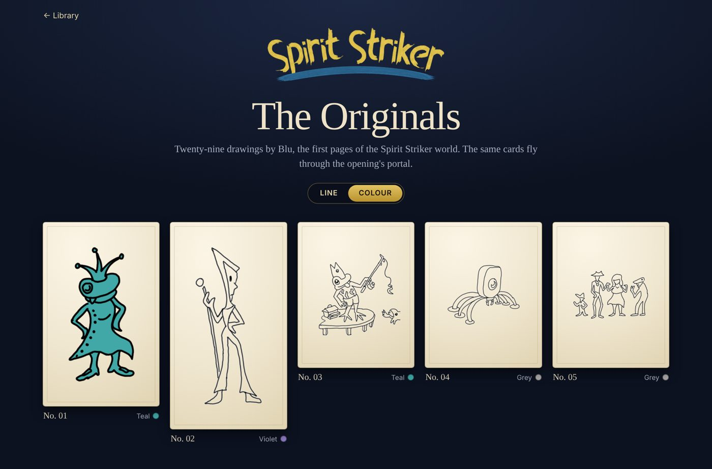
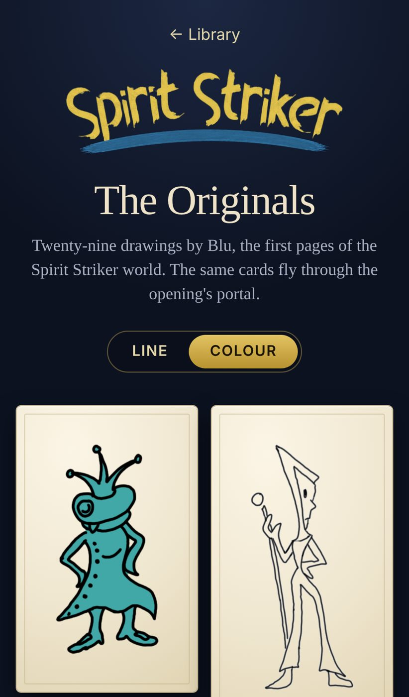
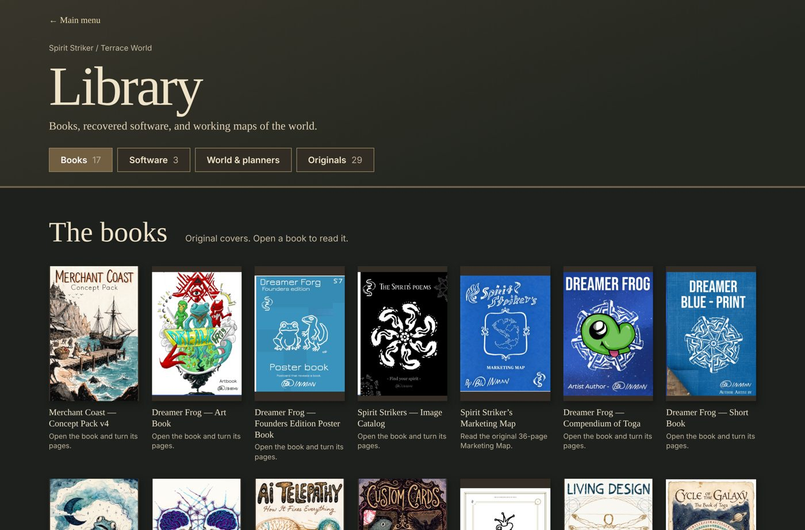

# Spirit Striker: Terrace World

The Spirit Striker opening intro, the main menu, and Dreamer Frog: Terrace World, playable in the browser.

The opening (`opening/`) is the TV-set intro: Blu's signature, the portal with the Spirit Strikers, the solar system, the Earth, and the town in Nevada. It plays first and then drops into the menu; the menu's Intro (bottom of the dial) replays it. The earlier opening is still at `intro-sequence.html`.

- **Solar system:** https://frog-dex.github.io/terrace-world/solar/ — the planets where they really are on any date from 1800 to 2050 (JPL's approximate orbital elements), drawn in the opening's style; set a date (a birthday works) and it travels there, with the Toga calendar day for that date. Drag to turn, scroll or pinch to zoom, tap a planet to fly to it.

- **Start here (intro → menu → Play):** https://frog-dex.github.io/terrace-world/
- **Jump straight into the game:** https://frog-dex.github.io/terrace-world/terrace-world.html
- **Multiplayer test:** https://frog-dex.github.io/terrace-world/mp-test.html (everyone who opens the link is in the same room)
- **Library (menu → Learn):** https://frog-dex.github.io/terrace-world/library.html — books, recovered software, world planners
- **The Originals:** https://frog-dex.github.io/terrace-world/originals.html — Blu's 29 original drawings, in line or in their flat colours

In the menu, Play, Learn, Intro and Radio work (Radio opens Wise Rock Fish in a new tab); Shop is closed in this copy.

## Screenshots

| The Originals (colour) | On a phone | Library |
| --- | --- | --- |
|  |  |  |

## Run it locally

It is a static site — no build step and no dependencies to install. Serve the folder over HTTP (opening the files straight from disk breaks the ES modules and `fetch` calls):

```sh
python3 -m http.server 8000
# then open http://localhost:8000/
```

The menu's town and some pages load three.js from cdnjs, so you need a network connection for the full scene. If the CDN can't be reached, the menu still comes up with the sign alone.

## What's where

| Path | What it is |
| --- | --- |
| `index.html` | Redirects to `opening/` |
| `opening/` | The current opening intro |
| `menu.html`, `menu.js`, `menu.css`, `menu-scene.css` | The drawn main-menu dial, set in the school town |
| `menu-town/` | The 3D town and sign behind the menu (`town/town-engine.js` is generated by `build_menu_town.py`) |
| `terrace-world.html` | The game (a single self-contained file). `world.html` is an identical copy kept for older links |
| `play-launch.*` | The portal transition from the menu into the game |
| `library.html`, `library.js`, `library.css` | The Library. `library.html` is generated — edit `library-catalog.json`, then run `python3 tools/build_library.py` |
| `originals.html`, `originals.js`, `originals.css` | The Originals gallery |
| `marketing-map.html`, `marketing-map-pages/` | Reader for the Marketing Map book |
| `solar/` | The solar-system page |
| `intro-*.html`, `intro-*.js` | Earlier intro scenes and their pieces |
| `assets/`, `images/`, `audio/`, `library-assets/`, `models/` | Art, sound and data |
| `mp-test.html` | Multiplayer test room |

See `LIBRARY-HANDOFF.md` for how the Library connects to spiritstriker.app.
